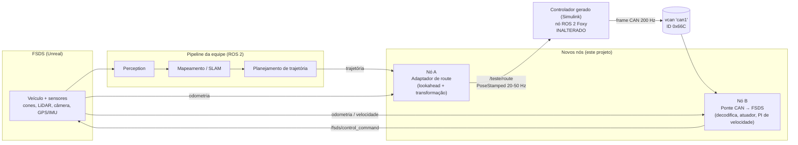

# Planejamento de Simulação do Controlador Autônomo FSAE (Stanley + CAN) no FSDS

> **Modelo:** `Controlador_teste_mockado` (Simulink 2023a, Embedded Coder, ROS 2 Foxy, ARM64)
> **Objetivo:** validar o controlador fora da bancada e fora do carro, em malha fechada, com a pipeline completa (perception → mapeamento → planejamento → controle) rodando junto.
> **Simulador base:** FSDS (Formula Student Driverless Simulator, Unreal/AirSim), já usado para validar mapeamento e perception.
> **Estratégia recomendada:** SIL com o **mesmo código gerado que vai pro carro**, usando CAN virtual (`vcan`) e dois nós adaptadores (route e ponte CAN → FSDS). Opcionalmente, evoluir para HIL com o Jetson.

---

## Sumário

0. [Resumo executivo](#0-resumo-executivo)
1. [Diagnóstico: o que o controlador realmente faz](#1-diagnóstico-o-que-o-controlador-realmente-faz)
2. [Objetivos, escopo e critérios de sucesso](#2-objetivos-escopo-e-critérios-de-sucesso)
3. [Alternativas avaliadas (vantagens e desvantagens)](#3-alternativas-avaliadas-vantagens-e-desvantagens)
4. [Arquitetura alvo](#4-arquitetura-alvo)
5. [Contratos de interface](#5-contratos-de-interface)
6. [Plano de execução por fases](#6-plano-de-execução-por-fases)
7. [Esqueletos de código](#7-esqueletos-de-código)
8. [Métricas, logs e critérios de aceite](#8-métricas-logs-e-critérios-de-aceite)
9. [Riscos, armadilhas e pontos de atenção](#9-riscos-armadilhas-e-pontos-de-atenção)
10. [Melhorias recomendadas no modelo (fora do escopo inicial)](#10-melhorias-recomendadas-no-modelo-fora-do-escopo-inicial)
11. [Checklist de execução e perguntas em aberto](#11-checklist-de-execução-e-perguntas-em-aberto)
12. [Anexos](#12-anexos)

---

## 0. Resumo executivo

**Problema:** o controle lateral já está implementado em Simulink e gerado em C++ (nó ROS 2 Foxy + SocketCAN), mas só foi testado em bancada. Não será mais possível testá-lo no carro. Queremos testá-lo em malha fechada junto com a pipeline que já roda no FSDS.

**Descoberta-chave da análise do código:** o controlador **não tem saída ROS**. Ele recebe um ponto alvo por `/teste/route` (`PoseStamped`) e envia o ângulo da coluna de direção por **CAN (`can1`, ID estendido `0x66C`)**. Ele também é **somente lateral**: não gera throttle nem freio.

**Decisão:** em vez de reescrever ou adaptar o modelo ao FSDS, adaptamos o **simulador ao controlador**. Isso preserva o binário que irá ao carro e valida de graça a codificação CAN (escala, endianness, razão 3,055, saturação, taxa de 200 Hz).

**Componentes novos a construir:**

| Componente | Função |
| :--- | :--- |
| **Nó A: adaptador de route** | Lê trajetória do planner + odometria, escolhe ponto de lookahead, converte para o referencial do eixo traseiro e publica em `/teste/route`. |
| **Nó B: ponte CAN → FSDS** | Lê o frame `0x66C` do `vcan`, decodifica o ângulo, normaliza e publica `/fsds/control_command`. Inclui atuador realista (atraso e limite de taxa) e um controle longitudinal simples (PI de velocidade). |
| **Ambiente reprodutível** | `vcan`, Docker/ROS 2 Foxy, scripts de lançamento, gravação de logs. |

**Ordem das fases:** levantamento → ambiente → controlador rodando no PC → ponte CAN → nó de route → malha fechada só com controle → realismo do atuador → pipeline completa → desmocagem → injeção de falhas → HIL (opcional) → automação.

---

## 1. Diagnóstico: o que o controlador realmente faz

### 1.1 Resumo da arquitetura

| Item | Valor |
| :--- | :--- |
| Algoritmo | Stanley cinemático (lateral) + máquina de estados (Stateflow) |
| Período de execução | 5 ms (200 Hz), timer de parede (`wall_timer`) |
| Entrada real | `/teste/route`, `geometry_msgs/msg/PoseStamped`, QoS `KEEP_LAST(10)`, `BEST_EFFORT`, `VOLATILE` |
| Campos usados da entrada | `pose.position.x` e `pose.position.y` (orientação é ignorada no mock) |
| Saída | Frame CAN `0x66C` (29 bits, DLC 8), em `can1`, 200 Hz |
| Sinal principal | Ângulo da coluna = ângulo da roda × **3,055**, int32 big-endian, escala 0,0001° |
| Limites do atuador (constantes) | Velocidade 3000 (raw 300), corrente/aceleração 15000 (raw 1500), ambos escala 10 |
| Saturação da roda | ±36° (coluna ±109,98°) |
| Parâmetros Stanley | `kp = 5`, `k_soft = 1`, `L = 1,6 m` |

### 1.2 O que está mockado (constantes)

| Sinal real | No mock | Consequência |
| :--- | :--- | :--- |
| Pose do carro (x, y, θ) | `(0, 0, 0)` | O carro é sempre a origem; o ponto de route precisa vir no referencial local. |
| `desired_yaw` | `0` | Termo de heading é sempre zero; o `x` do route não entra na conta. |
| Velocidade `v` | `1,0 m/s` | O ganho do termo de cross-track não varia com a velocidade real. |
| AS state (`Constant4`/`Constant5`) | `true` / `false` | Stateflow vai direto para `IN_HV` e nunca sai. |
| Direção de movimento | `1` (frente) | Só modo à frente. |

### 1.3 Lei de controle efetiva com os mocks

Com `x_c = y_c = θ_c = 0` e `ψ_d = 0`:

```
x_f = 1,6 m ; y_f = 0
dx  = x_f − x_route
dy  = y_f − y_route = −y_route
e   = −(dx·sin(0) − dy·cos(0)) = dy = −y_route
δ   = −( atan( kp·e / (v+1) ) + 0 ) = atan( 5·y_route / 2 ) = atan( 2,5 · y_route )
```

Conclusões importantes:

1. **O controlador, no mock, é um P não linear sobre o desvio lateral `y` do ponto alvo** (no referencial do carro). O `x` do ponto não influencia o resultado.
2. **O ganho é muito alto.** A roda satura em ±36° quando `2,5·y ≥ tan(36°) ≈ 0,727`, ou seja, com **|y| ≈ 0,29 m**.
3. Sinal: `y > 0` (esquerda, convenção ROS REP-103) gera `δ > 0` (esquerda no CAN, conforme a tabela de frames do seu `.md`).
4. A **distância de lookahead** escolhida pelo Nó A passa a ser parte do ganho efetivo do sistema.

### 1.4 Sensibilidade à velocidade (se `v` for desmocada)

Offset lateral do ponto alvo necessário para saturar a roda em 36°, com heading error zero:

| Velocidade `v` (m/s) | Fator `kp/(v+1)` | `|y|` que satura (m) |
| :---: | :---: | :---: |
| 1 (mock atual) | 2,50 | 0,29 |
| 3 | 1,25 | 0,58 |
| 5 | 0,83 | 0,87 |
| 8 | 0,56 | 1,31 |
| 10 | 0,45 | 1,60 |

Interpretação: o comportamento atual (calibrado/testado a 1 m/s) é **muito mais agressivo** do que será a velocidades reais caso `v` seja conectada. Se `v` continuar fixa em 1 m/s e o carro simulado andar a 8 m/s, o ganho efetivo estará **mal escalado** e o carro provavelmente oscilará. Isso é um achado a ser medido na simulação, não um defeito do simulador.

### 1.5 Observações e inconsistências a verificar no modelo

- **Unidades de `desired_yaw`:** o documento descreve `bus_route.desired_yaw` em graus, mas o código aplica `sin()`/`cos()` e subtrai de `currPose[2]` diretamente (radianos). Se a desmocagem alimentar `desired_yaw` em graus, haverá erro. **Verificar no modelo antes da Fase 8.**
- **`pos_theta` em `bus_imu`** aparece como "radians / degrees": também ambíguo.
- **Sem timeout de route:** se as mensagens pararem, `In1` mantém o último valor e o esterçamento fica congelado indefinidamente.
- **Stateflow sem saída exercitada:** como as constantes são fixas, a transição `HV → Idle` nunca é testada.
- **Sem controle longitudinal** neste modelo: throttle/freio precisam vir de outro lugar na simulação.

---

## 2. Objetivos, escopo e critérios de sucesso

### 2.1 Objetivos

1. Executar o **código C++ gerado do controlador** em malha fechada com o FSDS.
2. Rodar **mapeamento + perception + planejamento + controle** juntos, como no carro.
3. Validar a **interface CAN** (codificação e taxa) de ponta a ponta.
4. Expor problemas de **ganho, saturação, sinal, frame e latência** que a bancada não revela.
5. Produzir **métricas repetíveis** (regressão) para qualquer mudança futura no controle.

### 2.2 Dentro do escopo

- Controle lateral em malha fechada no FSDS.
- Adaptadores de interface (route e CAN → FSDS).
- Atuador de direção com atraso e limite de taxa (modelo simples).
- Injeção de falhas na comunicação.
- Automação da execução e das métricas.

### 2.3 Fora do escopo (por enquanto)

- Validação fina de ganhos por dinâmica de veículo de alta fidelidade (o modelo do FSDS é simplificado).
- Controle longitudinal real (será um PI simples só para o carro andar).
- Certificação de segurança funcional.

### 2.4 Critérios de sucesso do projeto

| Critério | Como medir |
| :--- | :--- |
| O nó gerado roda sem modificação lógica | Mesmo código-fonte do carro, só recompilado/regerado para o alvo da simulação |
| Frames CAN corretos | `candump` bate com a tabela de referência do `.md` (Seção 12.1) |
| Carro completa voltas em pista de teste | Voltas sem sair da pista, em velocidades crescentes |
| Erro lateral e taxa de esterçamento dentro de limites definidos | Métricas da Seção 8 |
| Comportamento sob falha é conhecido e documentado | Resultados da Fase 9 |

---

## 3. Alternativas avaliadas (vantagens e desvantagens)

### 3.1 Onde e como rodar o controlador

| # | Alternativa | Vantagens | Desvantagens | Veredito |
| :-: | :--- | :--- | :--- | :--- |
| **A** | **SIL com o código gerado + `vcan` + nós adaptadores + FSDS** | Testa o mesmo binário do carro; valida codificação CAN; sem dependência de MATLAB em runtime; fácil de automatizar e rodar em CI; barato | Precisa recompilar para x86 (ou usar Docker/QEMU); precisa de 2 nós de adaptação; atuador é simulado | **Recomendada (Fase principal)** |
| **B** | **HIL: nó rodando no Jetson, `can1` físico ↔ adaptador USB-CAN no PC com FSDS** | Valida driver CAN real, CPU e latência no hardware alvo; mais próxima do carro | Exige Jetson e adaptador USB-CAN disponíveis; setup de rede/CAN mais trabalhoso; menos fácil de automatizar | **Recomendada como fase 2 (se hardware disponível)** |
| **C** | Alterar o modelo para publicar o esterçamento em ROS (sem CAN) e ligar direto no FSDS | Integração mais simples, só um nó adaptador | Deixa de validar a saída CAN; o código simulado deixa de ser o do carro; você precisa manter duas variantes do modelo | Descartada como caminho principal. Aceitável só como atalho temporário |
| **D** | Co-simulação: rodar o `.slx` no MATLAB conectado ao ROS do FSDS | Depuração visual no Simulink; sem recompilar | Não testa o código gerado; tempo real frágil; exige MATLAB aberto; difícil de automatizar | Útil só para depuração pontual |
| **E** | Simulink + Vehicle Dynamics Blockset (controle isolado) | Dinâmica de veículo de alta fidelidade (pneus, suspensão); bom para ajustar ganhos | Não roda a pipeline de perception/mapeamento; cenário e modelo exigem trabalho | **Complementar**, não substitui o FSDS |
| **F** | Exportar controle como FMU para outra ferramenta | Portável para vários simuladores | Perde ROS e CAN nativos; esforço de integração alto | Só se for necessário usar outro simulador comercial |
| **G** | Replay de rosbags de testes reais | Valida lógica e regressões com dados reais; barato | Não fecha a malha; não mostra efeito do controle na trajetória | **Complementar** (bom para regressão da Fase 11) |

### 3.2 Qual simulador usar

| Simulador | Vantagens | Desvantagens | Veredito |
| :--- | :--- | :--- | :--- |
| **FSDS (atual)** | Já validado pela equipe para perception/mapeamento; pipeline completa roda junto; cones, LiDAR e câmera simulados; ponte ROS | Dinâmica de veículo simplificada; Unreal exige GPU decente | **Principal** |
| **eufs_sim (Gazebo + ROS 2)** | Padrão na comunidade Formula Student; boa documentação; dinâmica própria | Menos fotorrealista para câmera; exige adaptar a pipeline às interfaces dele | Segunda opinião opcional, para evitar vícios de um só simulador |
| **CARLA** | Unreal, sensores ricos, comunidade grande | Você precisaria montar o cenário FSAE (cones, pista); mais setup | Só se o FSDS limitar muito |
| **AirSim puro** | Base do FSDS; controle total | FSDS já resolve o caso | Desnecessário |
| **Gazebo próprio** | Controle total do veículo e da pista | Muito trabalho de construção | Desnecessário |

### 3.3 Como obter o executável do controlador no PC (x86)

O código foi gerado para **ARM64 (Jetson)**, com blocos CAN (`MW_CAN_*`) do pacote de suporte da MathWorks. Há quatro caminhos:

| # | Caminho | Vantagens | Desvantagens |
| :-: | :--- | :--- | :--- |
| 1 | **Regerar o código no Simulink para Linux x86-64** (Hardware Implementation → dispositivo Intel x86-64, Linux 64) e compilar em Ubuntu 20.04 + Foxy | Binário nativo e rápido; caminho mais simples | Precisa confirmar que os blocos CAN e as bibliotecas `MW_*` funcionam no alvo x86 (podem estar restritos ao Jetson) |
| 2 | **Build remoto pelo Simulink via SSH** em uma máquina Ubuntu 20.04 x86 (mesmo fluxo "Build and load" usado hoje para o Jetson) | Reaproveita o fluxo atual; as bibliotecas `MW_*` vêm resolvidas pelo toolchain da MathWorks | Exige uma máquina Linux dedicada e MATLAB para cada rebuild |
| 3 | **Empacotar o código com `packNGo`** e compilar em Docker | Autocontido; reprodutível; independe do MATLAB depois de empacotado | Precisa garantir que todas as fontes `MW_*` sejam incluídas no pacote |
| 4 | Rodar o binário ARM64 em Docker com **QEMU** | Não exige regerar | Lento; temporização de 200 Hz fica comprometida; CAN virtual fica complicado |

**Recomendação:** começar pelo caminho **1 ou 2** (qual for mais fácil no seu ambiente) e, quando estável, congelar o resultado no caminho **3** para reprodutibilidade (Docker). Evite o caminho 4.

### 3.4 Como escrever os nós adaptadores

| Opção | Vantagens | Desvantagens |
| :--- | :--- | :--- |
| **Python (`rclpy` + `python-can`)** | Rápido de escrever e depurar; suficiente para 100–200 Hz | Jitter maior que C++; GIL |
| C++ (`rclcpp` + SocketCAN) | Menor jitter; mais próximo do embarcado | Mais lento de desenvolver |

**Recomendação:** começar em **Python**. Migrar só se as métricas de jitter mostrarem que o adaptador atrapalha o resultado.

### 3.5 Referencial do ponto de route

| Opção | Vantagens | Desvantagens |
| :--- | :--- | :--- |
| **Ponto no referencial local do carro (eixo traseiro)** | Funciona com o modelo mockado **sem alterar nenhuma linha**; é o caminho mais rápido | Não exercita o termo de heading nem a pose real |
| Ponto global + desmocar a pose | Mais próximo do caso real completo | Exige alterar e regerar o modelo (Fase 8) |

**Recomendação:** começar com o **referencial local**, e desmocar só depois que a malha básica estiver funcionando.

---

## 4. Arquitetura alvo



### 4.1 Princípios de projeto

1. **Não alterar o controlador** na fase inicial. Toda adaptação fica nos nós A e B.
2. **O nó B imita o que o carro faz:** o atuador real recebe CAN, então a simulação também.
3. **Tudo é registrado** (rosbag2 + `candump -l`) para análise e regressão.
4. **Tempo real 1x:** o controlador usa timer de parede de 5 ms; o FSDS deve rodar em tempo real.

---

## 5. Contratos de interface

### 5.1 Tópicos e interfaces

| Interface | Direção | Tipo | Observações |
| :--- | :--- | :--- | :--- |
| `/teste/route` | Nó A → Controlador | `geometry_msgs/PoseStamped` | Apenas `position.x/y` são usados. Referencial do **eixo traseiro** (ver 5.3). Publicar a 20–50 Hz. QoS: o assinante é `BEST_EFFORT`, então o publicador pode ser `BEST_EFFORT` ou `RELIABLE` |
| CAN `can1`, ID `0x66C` (extended) | Controlador → Nó B | frame de 8 bytes | Ver 5.2 |
| `/fsds/control_command` | Nó B → FSDS | `fs_msgs/ControlCommand` | `throttle` (0..1), `steering` (normalizado -1..1), `brake` (0..1). **Conferir sinal e escala no FSDS** |
| `/fsds/testing_only/odom` | FSDS → Nós A e B | `nav_msgs/Odometry` | Ground truth (útil só para as fases iniciais). Depois trocar pela estimação real |

> Nomes exatos de tópicos e campos do FSDS devem ser conferidos na documentação da versão usada pela equipe.

### 5.2 Frame CAN `0x66C`

| Campo | Bytes | Tipo | Escala | Conteúdo |
| :--- | :--- | :--- | :--- | :--- |
| Ângulo da coluna | 0–3 | int32 big-endian | 0,0001 °/bit | `round(θ_coluna × 10000)` |
| Limite de velocidade | 4–5 | int16 big-endian | 10 | Constante 3000 → raw 300 (`0x012C`) |
| Limite de corrente/aceleração | 6–7 | int16 big-endian | 10 | Constante 15000 → raw 1500 (`0x05DC`) |

Decodificação para o simulador:

```
raw        = int32_be(data[0:4])
coluna_deg = raw × 0,0001
roda_deg   = coluna_deg / 3,055
```

### 5.3 Referenciais e convenções

| Item | Convenção do controlador | O que verificar no FSDS |
| :--- | :--- | :--- |
| Eixos do carro | ROS REP-103: x à frente, **y à esquerda**, z para cima | O FSDS (AirSim) usa NED na API Python e pode usar ENU nos tópicos ROS. Confirmar o frame de cada tópico |
| Sinal do esterçamento no CAN | Positivo = **esquerda** (tabela do `.md`) | No FSDS o steering positivo pode ser **direita**. **Medir empiricamente** e usar o parâmetro `steering_sign` no Nó B |
| Origem do referencial de route | **Eixo traseiro** (o controlador soma `L = 1,6 m` para chegar ao eixo dianteiro) | A origem da odometria do FSDS pode ser o centro do carro. Aplicar o deslocamento até o eixo traseiro no Nó A |
| Unidades | Ângulos em graus no CAN; radianos internamente no Stanley | Conferir antes de desmocar `desired_yaw` |

### 5.4 Parâmetros do veículo a levantar

| Parâmetro | Valor no controlador | Valor no FSDS | Ação |
| :--- | :--- | :--- | :--- |
| Entre-eixos | 1,6 m | **a conferir** | Se diferir muito, ajustar o veículo no FSDS ou documentar a discrepância |
| Ângulo máximo da roda | ±36° | **a conferir** (define a normalização do steering) | Medir: comandar steering = 1 e ler o ângulo real da roda |
| Razão coluna/roda | 3,055 | n/a | Só entra na codificação CAN |
| Velocidade máxima de esterçamento | `3000` (raw 300), unidade a confirmar no datasheet do atuador | n/a | Usada para dimensionar o limite de taxa do atuador simulado |

---

## 6. Plano de execução por fases

> Ordem pensada para **isolar um problema por vez**. Não avance de fase sem cumprir o critério de aceite da anterior.

### Fase 0: Levantamento e decisões prévias

**Objetivo:** eliminar incertezas que mudam o desenho.

**Por quê:** metade dos problemas de integração vêm de suposições erradas sobre frames, sinais e versões.

**Tarefas:**

1. Confirmar **como o planner de vocês publica a trajetória** (tópico, tipo, frame, taxa: `nav_msgs/Path`? pontos soltos? global ou local?).
2. Confirmar **qual distância de lookahead o planner real usa** (ela define o ganho efetivo, ver 1.3).
3. Confirmar a **distro suportada pela ponte ROS do FSDS** na versão que vocês usam (Foxy ou Humble).
4. Confirmar a **versão do MATLAB** (2023a) e quais distros do ROS 2 o ROS Toolbox dessa versão suporta.
5. Levantar **parâmetros do veículo no FSDS** (entre-eixos, ângulo máximo, frame da odometria, origem da odometria).
6. Verificar **disponibilidade do Jetson e de um adaptador USB-CAN** (define se a Fase 10 é viável).
7. Definir o **sistema operacional** da máquina de simulação (ver Fase 1).

**Entregável:** planilha ou nota com as respostas acima.

**Critério de aceite:** todas as perguntas da Seção 11.2 respondidas ou com plano de investigação.

---

### Fase 1: Ambiente de simulação

**Objetivo:** ter FSDS, ROS 2, `vcan` e Docker funcionando de forma reprodutível.

**Por quê:** o controlador usa SocketCAN do kernel Linux e timer de parede de 5 ms. O ambiente precisa ser Linux com CAN virtual e CPU sem disputa.

**Decisões e recomendações:**

| Decisão | Recomendação | Motivo |
| :--- | :--- | :--- |
| Sistema operacional | **Ubuntu nativo (20.04 ou 22.04)** na máquina de simulação | `vcan` funciona nativamente. WSL2 pode não trazer o módulo `vcan` no kernel padrão (precisaria de kernel customizado) |
| Distro ROS 2 do controlador | **Foxy** (em Docker, se o host não for 20.04) | É a mesma do embarcado; evita validar uma coisa e embarcar outra |
| Distro do resto da pilha | A que o FSDS e a pipeline já usam | Foxy e Humble costumam interoperar via DDS para mensagens padrão, mas **teste** |
| Rede Docker | `--network host` e mesmo `ROS_DOMAIN_ID` | Evita problemas de descoberta DDS |
| `fs_msgs` | Compilar o pacote nos ambientes que publicam/assinam `ControlCommand` | Mensagem custom do FSDS |

**Passos:**

1. Instalar/configurar o FSDS e conferir que a pipeline atual (perception + mapeamento) roda como hoje.
2. Criar o CAN virtual:

   ```bash
   sudo modprobe vcan
   sudo ip link add dev can1 type vcan
   sudo ip link set up can1
   ```

3. Instalar utilitários CAN e `python-can`:

   ```bash
   sudo apt install can-utils
   pip install python-can
   ```

4. Criar o container (ou ambiente) Foxy para o controlador e os nós adaptadores. Montar um workspace `colcon` com `fs_msgs`.
5. Configurar o FSDS para **tempo real** (`ClockSpeed = 1.0` no `settings.json`).
6. Fixar a CPU do controlador, se possível (governor `performance`, evitar tarefas pesadas concorrentes).
7. Testar a descoberta DDS entre os ambientes (`ros2 topic list` vendo os tópicos do FSDS).

**Entregável:** scripts de setup (`setup_vcan.sh`, `Dockerfile`, `docker-compose.yml` ou equivalente).

**Critério de aceite:** `ros2 topic list` mostra os tópicos do FSDS; `candump can1` abre sem erro; pipeline atual de perception e mapeamento continua funcionando.

---

### Fase 2: Controlador rodando no PC, sem simulador

**Objetivo:** executar o nó gerado no PC e ver o frame CAN correto no `vcan`.

**Por quê:** valida o binário e a codificação CAN isoladamente, antes de qualquer complexidade de simulação.

**Passos:**

1. Obter o executável para x86 (ver 3.3: caminho 1, 2 ou 3).
   - Se regerar: Configuration Parameters → Hardware Implementation → escolher dispositivo Intel x86-64 (Linux 64) com a placa ROS 2; manter solver de passo fixo igual ao do carro.
   - Se os blocos CAN não gerarem para x86, registrar o erro e usar o caminho 2 (build remoto).
2. Rodar o nó e monitorar o CAN:

   ```bash
   candump can1
   # Esperado com route = (qualquer x, 0): can1  0000066C   [8]  00 00 00 00 01 2C 05 DC
   ```

3. Publicar pontos fixos e comparar com a tabela de referência (Seção 12.1):

   ```bash
   ros2 topic pub -r 20 /teste/route geometry_msgs/msg/PoseStamped \
     "{header: {frame_id: base}, pose: {position: {x: 5.0, y: 0.0, z: 0.0}}}"
   ```

   Repetir com `y = 0,05`, `0,1`, `0,3`, `-0,1`, `-0,3`.

4. Verificar a **taxa dos frames** (`candump -td` ou `cansniffer`): deve ser ~200 Hz (5 ms).

**Valores esperados (mock com v = 1, routes em y):**

| `y_route` (m) | δ = atan(2,5·y) (°) | Coluna (°) = δ × 3,055 |
| :---: | :---: | :---: |
| 0 | 0 | 0 |
| 0,05 | 7,13 | 21,8 |
| 0,10 | 14,04 | 42,9 |
| 0,29 | 35,9 | 109,7 (próximo da saturação) |
| ≥ 0,30 | 36 (saturado) | 109,98 |

**Entregável:** log do `candump` e comparação com os valores acima.

**Critério de aceite:** frames idênticos aos esperados (diferença ≤ 1 contagem de raw por arredondamento); taxa de ~200 Hz estável; ângulo saturando em ±109,98° para |y| grande.

---

### Fase 3: Nó B (ponte CAN → FSDS) e calibração de sinal e escala

**Objetivo:** fazer o FSDS obedecer ao controlador, com sinal e magnitude corretos.

**Por quê:** é o ponto onde mais ocorrem erros silenciosos (sinal invertido, escala errada, unidades).

**Passos:**

1. Implementar o Nó B (esqueleto na Seção 7.1) com os parâmetros:
   - `max_wheel_deg_fsds`: ângulo da roda correspondente a steering = ±1 no FSDS;
   - `steering_sign`: +1 ou -1;
   - `can_channel`: `can1`.
2. **Teste unitário da decodificação** com os valores da tabela da Seção 12.1 (por exemplo `00 04 A9 5C` → +30,55° de coluna → +10,00° de roda).
3. **Calibração do FSDS:** com o carro parado, publicar `steering = +0,5` e `-0,5` em `/fsds/control_command` e observar para qual lado o carro esterça. Definir `steering_sign` de acordo.
4. **Calibração da escala:** medir (visualmente ou por IMU/odometria) o ângulo da roda para `steering = 1` e preencher `max_wheel_deg_fsds`.
5. Ligar controlador + Nó B + FSDS e enviar `y_route` fixo: o carro deve esterçar para o lado correto e com a magnitude esperada.

**Entregável:** Nó B funcionando; tabela de calibração (steering normalizado ↔ ângulo da roda).

**Critério de aceite:** `y_route > 0` esterça à esquerda e `y_route < 0` à direita; magnitude do esterçamento proporcional ao esperado (±5%).

---

### Fase 4: Nó A (adaptador de route) com ground truth

**Objetivo:** gerar o ponto alvo no referencial correto a partir da trajetória e da odometria.

**Por quê:** a qualidade desse ponto define o resultado. Erros de frame ou de origem aparecem como "controlador ruim".

**Passos:**

1. Implementar o Nó A (esqueleto na Seção 7.2):
   - ler a trajetória (use o tópico real do seu planner ou, na primeira rodada, a **linha central ground truth** do FSDS, por exemplo `/fsds/testing_only/track`);
   - ler a odometria (`/fsds/testing_only/odom`);
   - achar o ponto mais próximo na trajetória e avançar `lookahead` metros ao longo dela;
   - transformar o ponto para o referencial do carro, **deslocando a origem para o eixo traseiro** se a odometria não estiver nele;
   - publicar em `/teste/route` a 20–50 Hz.
2. **Parametrizar o lookahead** (fixo ou em função da velocidade) e registrá-lo.
3. Validar visualmente no RViz ou Foxglove: ponto alvo à frente do carro, sobre a trajetória.
4. Validar o frame com um teste simples: com o carro parado e alinhado à trajetória, `y_route` deve ser ~0. Rotacionar o carro e conferir o sinal de `y_route`.

**Decisões e recomendações:**

| Decisão | Recomendação | Motivo |
| :--- | :--- | :--- |
| Lookahead | Começar **igual ao do planner real**; depois varrer valores | O lookahead faz parte do ganho efetivo (Seção 1.3) |
| Taxa de publicação | 30 Hz | Dentro do intervalo do seu roteiro (20–50 Hz) e muito abaixo dos 200 Hz do controle |
| Fonte da trajetória | Ground truth nas Fases 4–6; trajetória do planner real na Fase 7 | Isola bugs do controle antes de misturar os da pipeline |

**Entregável:** Nó A publicando; visualização validada.

**Critério de aceite:** `/teste/route` coerente com a geometria (sinal e magnitude); taxa estável.

---

### Fase 5: Malha fechada só com controle (ground truth)

**Objetivo:** ver o controlador conduzindo o carro na pista, com odometria e trajetória perfeitas.

**Por quê:** se o carro não segue a pista aqui, o problema é do **controle ou das interfaces**, não de perception ou mapeamento.

**Passos:**

1. Escolher uma pista de teste do FSDS (de preferência com curvas de raios variados). Começar por uma pista simples.
2. Configurar o PI de velocidade do Nó B com **alvo constante baixo** (por exemplo 2 m/s).
3. Rodar e gravar tudo (rosbag2 + `candump -l`).
4. Aumentar o alvo em degraus (por exemplo 2 → 4 → 6 → 8 m/s), repetindo.
5. Para cada degrau, calcular as métricas da Seção 8.
6. **Investigar o comportamento do ganho:** espere oscilação em velocidade maior, pelo ganho alto e pela velocidade fixa em 1 m/s (Seção 1.4). Registrar a velocidade em que o carro começa a oscilar.
7. **Varrer o lookahead** (por exemplo 3, 4, 5, 6, 8 m) e registrar o efeito nas métricas.

**Hipóteses a testar:**

| Hipótese | Teste | Resultado esperado |
| :--- | :--- | :--- |
| Ganho muito alto com `v` fixa | Aumentar a velocidade | Oscilação cresce com a velocidade |
| Lookahead curto piora a oscilação | Varrer lookahead | Menor lookahead → mais oscilação |
| Saturação frequente em ±36° | Histograma do esterçamento | Muitas amostras no limite se o ganho estiver alto |

**Entregável:** relatório com métricas por velocidade e por lookahead.

**Critério de aceite:** o carro completa voltas pelo menos na velocidade-alvo mais baixa; resultados registrados e reprodutíveis (repetir 3 vezes e comparar).

---

### Fase 6: Realismo do atuador e da comunicação

**Objetivo:** aproximar o comportamento da direção real.

**Por quê:** o FSDS obedece ao steering instantaneamente; o motor de direção real tem **atraso e limite de velocidade**, o que muda a estabilidade da malha.

**Passos:**

1. Adicionar ao Nó B um **modelo de atuador**:
   - **limite de taxa** (°/s da roda), baseado no datasheet/medição do atuador (o controlador envia "velocidade 3000", unidade a confirmar);
   - **atraso de primeira ordem** (constante de tempo medida no banco, por exemplo 30–100 ms; use o valor medido, não o exemplo);
   - **limites de posição** (±36° na roda).
2. Adicionar **latência de comunicação** configurável (atraso em ms) entre o frame CAN e o FSDS.
3. Opcionalmente adicionar **ruído** na odometria usada pelo Nó A.
4. **Medir os parâmetros do atuador real na bancada:** aplicar degraus de ângulo e registrar o tempo de resposta e a taxa máxima. Sem isso, os parâmetros são chute.
5. Repetir os testes da Fase 5 e comparar as métricas com e sem atuador realista.

**Decisões e recomendações:**

| Decisão | Recomendação | Motivo |
| :--- | :--- | :--- |
| Origem dos parâmetros do atuador | **Medir no atuador real** | É o dado que o FSDS não fornece e que mais afeta a estabilidade |
| Onde aplicar o modelo | No Nó B, parametrizável | Fácil de ligar/desligar e comparar |

**Entregável:** Nó B com modelo de atuador configurável; comparação de métricas.

**Critério de aceite:** resultados comparados com e sem atuador; parâmetros documentados com fonte (medição ou datasheet).

---

### Fase 7: Pipeline completa (perception + mapeamento + planejamento + controle)

**Objetivo:** fechar o laço com as fontes reais da pipeline.

**Por quê:** é o objetivo final. Mostra como erros de mapeamento e de planejamento afetam o controle.

**Passos:**

1. Trocar a trajetória ground truth da Nó A pela **saída do planner real**.
2. Trocar a odometria ground truth pela **estimação real** (GPS/IMU/SLAM da pipeline).
3. Rodar com a pipeline completa e registrar as métricas.
4. Comparar com os resultados da Fase 5/6 (ground truth) para **atribuir erros** a cada bloco (perception, mapeamento, planejamento, controle).
5. Verificar a carga de CPU/GPU e a latência ponta a ponta (da percepção ao comando).

**Decisões e recomendações:**

| Decisão | Recomendação | Motivo |
| :--- | :--- | :--- |
| Ordem de troca | Primeiro a trajetória, depois a odometria | Separa efeitos de planejamento dos de localização |
| Máquinas | Se possível, pipeline e FSDS em máquinas separadas, mesmo domínio ROS | O FSDS consome GPU e CPU; isso pode atrasar o controlador |

**Entregável:** relatório comparando ground truth vs pipeline completa.

**Critério de aceite:** voltas completas com pipeline real; diferença para o ground truth quantificada.

---

### Fase 8: Desmocagem do controlador (malha realmente fechada)

**Objetivo:** substituir os mocks por entradas reais, no modelo.

**Por quê:** até aqui o controlador não conhecia a pose, a velocidade nem o `desired_yaw` reais. O comportamento a velocidade real só é conhecido com a desmocagem. Esta é a primeira fase em que o **modelo é alterado**.

**Passos:**

1. **Verificar as unidades** de `desired_yaw` e `pos_theta` no modelo (graus ou radianos; ver 1.5) e **uniformizar**.
2. Substituir `Constant3` (velocidade) por assinatura da velocidade longitudinal real (odometria ou estimador).
3. Substituir `currPose` por assinatura de odometria/localização.
4. Extrair o yaw do `PoseStamped.pose.orientation` (quaternion → yaw: `ψ = atan2(2(wz + xy), 1 − 2(y² + z²))`) e alimentar `desired_yaw` na unidade correta.
5. Passar a publicar o ponto alvo em referencial **global** (o Nó A deixa de transformar, só publica o ponto e o yaw da tangente).
6. Regerar o código e repetir os testes da Fase 5.
7. Comparar com a versão mockada.

**Atenção:** com `v` real, o ganho do termo de cross-track cai (tabela da Seção 1.4). Pode ser necessário **reajustar `kp`**, ou introduzir *gain scheduling*.

**Entregável:** nova versão do modelo e relatório de comparação.

**Critério de aceite:** comportamento estável nas velocidades-alvo; diferenças em relação ao mock explicadas.

---

### Fase 9: Injeção de falhas e robustez

**Objetivo:** conhecer o comportamento do sistema sob falhas de comunicação e de estado.

**Por quê:** o código atual não tem tratamento de timeout; o que acontece em falha é desconhecido.

**Testes sugeridos:**

| Falha | Como injetar | O que observar |
| :--- | :--- | :--- |
| Parada do route | Nó A para de publicar por 0,5 s, 1 s, 2 s | O esterçamento congela no último valor? O carro sai da pista? |
| Atraso do route | Atraso de 50, 100, 200 ms | Margem de estabilidade |
| Perda de pacotes | Descartar 10%, 30%, 50% | Efeito do `BEST_EFFORT` e do `In1` retendo o valor |
| Route com salto | Ponto alvo muda abruptamente | Reação e saturação |
| Route com NaN/Inf | Publicar valores inválidos | Se há tratamento (`rt_nonfinite`) |
| Transição para `Idle` | (requer controles expostos; ver Seção 10) | Se o esterçamento é desabilitado e o frame deixa de ser enviado |
| Parada do Nó B | Matar o nó | Comportamento do carro no FSDS |

**Entregável:** tabela de resultados por falha, com recomendações.

**Critério de aceite:** cada falha tem resultado documentado; falhas críticas viram itens da Seção 10.

---

### Fase 10 (opcional): HIL com Jetson e CAN real

**Objetivo:** validar o código no hardware alvo e o driver CAN real.

**Por quê:** o SIL não valida driver CAN, carga de CPU nem latência no hardware real.

**Passos:**

1. Ligar o `can1` do Jetson a um **adaptador USB-CAN** (por exemplo PEAK, candleLight) no PC que roda o Nó B. Terminar o barramento com 120 Ω nas duas pontas.
2. Configurar o bitrate igual nos dois lados:

   ```bash
   sudo ip link set can0 up type can bitrate <BITRATE_DO_CARRO>
   ```

3. Rodar o controlador no Jetson (assinando `/teste/route` pela rede ROS 2, em `ROS_DOMAIN_ID` comum).
4. No PC, o Nó B lê o CAN do adaptador (por exemplo `can0`).
5. Repetir os testes das Fases 5 a 9 e comparar com o SIL.
6. Medir carga de CPU do Jetson e latência.

**Vantagens:** valida driver CAN, hardware, carga e latência reais.
**Desvantagens:** exige o Jetson e o adaptador; a rede entre as máquinas adiciona latência no `/teste/route` (que também existe no carro se a pipeline estiver em outra máquina).

**Critério de aceite:** resultados do HIL consistentes com o SIL; diferenças explicadas.

---

### Fase 11: Automação, regressão e relatório

**Objetivo:** tornar os testes repetíveis para qualquer mudança futura.

**Passos:**

1. Criar um **script único** que sobe o ambiente (vcan, FSDS, pipeline, controlador, nós A e B), roda uma pista e uma velocidade, grava logs e encerra.
2. Gerar **métricas automaticamente** (Seção 8) a partir do rosbag e do log CAN.
3. Definir um **conjunto de cenários de regressão** (por exemplo 2 pistas × 3 velocidades × com/sem falha).
4. Fixar **limiares de aceite** (por exemplo erro lateral RMS máximo, nenhum cone derrubado, taxa de esterçamento máxima).
5. Registrar versões (commit do modelo, versão do FSDS, parâmetros) junto de cada execução.
6. Opcional: executar em CI quando houver máquina com GPU.

**Entregável:** pipeline de regressão e relatório-modelo.

**Critério de aceite:** um comando roda todos os cenários e imprime aprovado/reprovado por critério.

---

## 7. Esqueletos de código

> Esqueletos para acelerar o início. Ajuste nomes de tópicos, tipos e campos conforme a versão do FSDS e da pipeline de vocês, e **valide cada trecho na Fase correspondente**.

### 7.1 Nó B: ponte CAN → FSDS (Python)

```python
#!/usr/bin/env python3
"""Nó B: lê o frame CAN 0x66C do controlador e comanda o FSDS."""
import math
import struct

import can
import rclpy
from rclpy.node import Node
from nav_msgs.msg import Odometry
from fs_msgs.msg import ControlCommand  # pacote do FSDS (conferir)

CAN_ID = 0x66C
ANGLE_SCALE = 0.0001      # graus por contagem
COLUMN_RATIO = 3.055      # coluna / roda


def decode_frame(data: bytes):
    """Retorna (roda_deg, coluna_deg, lim_vel, lim_corrente)."""
    raw_angle = struct.unpack(">i", data[0:4])[0]
    lim_vel = struct.unpack(">h", data[4:6])[0] * 10.0
    lim_cur = struct.unpack(">h", data[6:8])[0] * 10.0
    coluna_deg = raw_angle * ANGLE_SCALE
    return coluna_deg / COLUMN_RATIO, coluna_deg, lim_vel, lim_cur


class CanToFsds(Node):
    def __init__(self):
        super().__init__("can_to_fsds")
        self.declare_parameter("can_channel", "can1")
        self.declare_parameter("max_wheel_deg_fsds", 25.0)   # MEDIR no FSDS
        self.declare_parameter("steering_sign", 1.0)         # +1 ou -1 (MEDIR)
        self.declare_parameter("wheel_limit_deg", 36.0)
        self.declare_parameter("rate_limit_deg_s", 200.0)    # MEDIR no atuador
        self.declare_parameter("lag_tau_s", 0.05)            # MEDIR no atuador
        self.declare_parameter("target_speed", 2.0)
        self.declare_parameter("kp_v", 0.3)
        self.declare_parameter("ki_v", 0.1)
        self.declare_parameter("rate_hz", 100.0)

        p = self.get_parameter
        self.bus = can.interface.Bus(channel=p("can_channel").value,
                                     interface="socketcan",
                                     can_filters=[{"can_id": CAN_ID,
                                                   "can_mask": 0x1FFFFFFF,
                                                   "extended": True}])
        self.cmd_wheel_deg = 0.0   # último comando decodificado
        self.act_wheel_deg = 0.0   # estado do atuador simulado
        self.speed = 0.0
        self.int_err = 0.0
        self.dt = 1.0 / p("rate_hz").value

        self.pub = self.create_publisher(ControlCommand,
                                         "/fsds/control_command", 10)
        self.create_subscription(Odometry, "/fsds/testing_only/odom",
                                 self.on_odom, 10)
        self.create_timer(self.dt, self.step)

    def on_odom(self, msg: Odometry):
        v = msg.twist.twist.linear
        self.speed = math.hypot(v.x, v.y)   # conferir frame do twist

    def drain_can(self):
        """Lê todos os frames pendentes e fica com o mais recente."""
        while True:
            m = self.bus.recv(timeout=0.0)
            if m is None:
                break
            if m.arbitration_id == CAN_ID and len(m.data) == 8:
                self.cmd_wheel_deg = decode_frame(bytes(m.data))[0]

    def step(self):
        p = self.get_parameter
        self.drain_can()

        # Atuador: limite de posição, limite de taxa e atraso de 1ª ordem
        lim = p("wheel_limit_deg").value
        target = max(-lim, min(lim, self.cmd_wheel_deg))
        tau = p("lag_tau_s").value
        desired = self.act_wheel_deg + (target - self.act_wheel_deg) * (
            self.dt / (tau + self.dt))
        max_step = p("rate_limit_deg_s").value * self.dt
        delta = max(-max_step, min(max_step, desired - self.act_wheel_deg))
        self.act_wheel_deg += delta

        # Normalização para o FSDS
        steering = (p("steering_sign").value * self.act_wheel_deg
                    / p("max_wheel_deg_fsds").value)
        steering = max(-1.0, min(1.0, steering))

        # Controle longitudinal simples (PI) para o carro andar
        err = p("target_speed").value - self.speed
        self.int_err = max(-5.0, min(5.0, self.int_err + err * self.dt))
        u = p("kp_v").value * err + p("ki_v").value * self.int_err
        throttle = max(0.0, min(1.0, u))
        brake = max(0.0, min(1.0, -u)) if err < -1.0 else 0.0

        msg = ControlCommand()
        msg.header.stamp = self.get_clock().now().to_msg()
        msg.throttle = float(throttle)
        msg.steering = float(steering)
        msg.brake = float(brake)
        self.pub.publish(msg)


def main():
    rclpy.init()
    rclpy.spin(CanToFsds())


if __name__ == "__main__":
    main()
```

**Teste unitário da decodificação (Fase 3):**

```python
def test_decode():
    # Moderado à esquerda: roda +10°, coluna +30,55° (raw 305500 = 0x0004A95C)
    roda, coluna, _, _ = decode_frame(bytes.fromhex("0004A95C012C05DC"))
    assert abs(coluna - 30.55) < 1e-6
    assert abs(roda - 10.0) < 1e-2
    # Moderado à direita
    roda, _, _, _ = decode_frame(bytes.fromhex("FFFB56A4012C05DC"))
    assert abs(roda + 10.0) < 1e-2
```

### 7.2 Nó A: adaptador de route (Python)

```python
#!/usr/bin/env python3
"""Nó A: transforma o ponto de lookahead para o referencial do eixo traseiro
e publica em /teste/route."""
import math

import numpy as np
import rclpy
from rclpy.node import Node
from geometry_msgs.msg import PoseStamped
from nav_msgs.msg import Odometry, Path   # ajustar ao tipo real do seu planner


def yaw_from_quat(q):
    return math.atan2(2.0 * (q.w * q.z + q.x * q.y),
                      1.0 - 2.0 * (q.y * q.y + q.z * q.z))


class RouteAdapter(Node):
    def __init__(self):
        super().__init__("route_adapter")
        self.declare_parameter("path_topic", "/planner/path")      # AJUSTAR
        self.declare_parameter("odom_topic", "/fsds/testing_only/odom")
        self.declare_parameter("lookahead", 5.0)                   # metros
        self.declare_parameter("rear_axle_offset", 0.0)            # MEDIR: odom -> eixo traseiro (m, + à frente)
        self.declare_parameter("rate_hz", 30.0)

        self.path = None     # array Nx2 em coordenadas do frame da odometria
        self.pose = None     # (x, y, yaw)
        self.create_subscription(Path, self.get_parameter("path_topic").value,
                                 self.on_path, 10)
        self.create_subscription(Odometry, self.get_parameter("odom_topic").value,
                                 self.on_odom, 10)
        self.pub = self.create_publisher(PoseStamped, "/teste/route", 10)
        self.create_timer(1.0 / self.get_parameter("rate_hz").value, self.step)

    def on_path(self, msg: Path):
        self.path = np.array([[p.pose.position.x, p.pose.position.y]
                              for p in msg.poses])

    def on_odom(self, msg: Odometry):
        o = msg.pose.pose
        self.pose = (o.position.x, o.position.y, yaw_from_quat(o.orientation))

    def lookahead_point(self, x, y):
        d = np.hypot(self.path[:, 0] - x, self.path[:, 1] - y)
        i = int(np.argmin(d))
        acc, L = 0.0, self.get_parameter("lookahead").value
        while i < len(self.path) - 1 and acc < L:
            acc += float(np.hypot(*(self.path[i + 1] - self.path[i])))
            i += 1
        return self.path[i]

    def step(self):
        if self.path is None or len(self.path) < 2 or self.pose is None:
            return
        x, y, yaw = self.pose
        off = self.get_parameter("rear_axle_offset").value
        # origem no eixo traseiro (odom pode estar no centro do carro)
        xr = x - off * math.cos(yaw)
        yr = y - off * math.sin(yaw)

        px, py = self.lookahead_point(xr, yr)
        dx, dy = px - xr, py - yr
        # rotaciona para o referencial do carro (x à frente, y à esquerda)
        lx = math.cos(-yaw) * dx - math.sin(-yaw) * dy
        ly = math.sin(-yaw) * dx + math.cos(-yaw) * dy

        msg = PoseStamped()
        msg.header.stamp = self.get_clock().now().to_msg()
        msg.header.frame_id = "rear_axle"
        msg.pose.position.x = lx
        msg.pose.position.y = ly
        msg.pose.orientation.w = 1.0
        self.pub.publish(msg)


def main():
    rclpy.init()
    rclpy.spin(RouteAdapter())


if __name__ == "__main__":
    main()
```

> **Atenção:** se o frame da odometria do FSDS for NED (y para a direita, z para baixo), a rotação acima precisa ser ajustada para que `y_local > 0` signifique esquerda. Faça o teste de sinal descrito na Fase 4 (passo 4).

### 7.3 Script de gravação de logs

```bash
#!/usr/bin/env bash
# Grava tudo de um experimento. Uso: ./gravar.sh nome_do_teste
set -e
OUT=logs/$1_$(date +%Y%m%d_%H%M%S)
mkdir -p "$OUT"

candump -l -f "$OUT/can.log" can1 &            # tráfego CAN bruto
CAN_PID=$!

ros2 bag record -o "$OUT/bag" \
  /teste/route /fsds/control_command /fsds/testing_only/odom \
  /fsds/testing_only/track &
BAG_PID=$!

trap "kill $CAN_PID $BAG_PID" EXIT
wait
```

---

## 8. Métricas, logs e critérios de aceite

### 8.1 O que gravar em cada execução

| Dado | Fonte | Uso |
| :--- | :--- | :--- |
| Frames CAN brutos | `candump -l` | Validar codificação, taxa e jitter |
| `/teste/route` | rosbag2 | Reconstruir o ponto alvo |
| `/fsds/control_command` | rosbag2 | Comando enviado ao simulador |
| Odometria (ground truth e estimada) | rosbag2 | Calcular erros |
| Linha central da pista (ground truth) | rosbag2 | Calcular erro lateral |
| Parâmetros e versões | arquivo de metadados | Reprodutibilidade |

### 8.2 Métricas

| Métrica | Definição | Para quê |
| :--- | :--- | :--- |
| **Erro lateral (RMS e máximo)** | Distância do eixo do carro à linha central | Qualidade do seguimento |
| **Taxa de esterçamento (RMS e máxima)** | Derivada do ângulo da roda | Suavidade e exigência do atuador |
| **% de tempo saturado** | Fração do tempo com |δ| = 36° | Indica ganho excessivo |
| **Oscilação** | Frequência e amplitude do esterçamento em retas | Estabilidade |
| **Cones derrubados / saídas de pista** | Eventos do FSDS | Critério de aprovação |
| **Tempo de volta** | Cronometragem por volta | Desempenho |
| **Período dos frames CAN (média e jitter)** | `candump -td` | Validar os 200 Hz |
| **Latência ponta a ponta** | `stamp` de `/teste/route` até o comando no FSDS | Impacto da comunicação |
| **Tempo de execução do `step()`** | Medição no nó | Validar a folga de CPU (documento indica < 100 µs) |

### 8.3 Critérios de aceite sugeridos (ajustar com a equipe)

| Critério | Sugestão |
| :--- | :--- |
| Saída de pista / cones derrubados | 0 em 3 voltas consecutivas |
| Erro lateral máximo | Definir a partir da largura da pista (por exemplo < 30% da largura útil) |
| Tempo saturado | Definir um limite (por exemplo < 5% fora de curvas fechadas) |
| Jitter dos frames CAN | Definir (por exemplo < 1 ms em torno de 5 ms) |
| Repetibilidade | Variação entre 3 execuções iguais dentro de uma tolerância definida |

Os números acima são pontos de partida: defina os limiares com base nos requisitos de dinâmica do carro e nos resultados das Fases 5 e 6.

---

## 9. Riscos, armadilhas e pontos de atenção

| # | Risco | Impacto | Mitigação |
| :-: | :--- | :--- | :--- |
| 1 | **Ganho alto do Stanley mockado** (satura com 0,29 m de offset) | Oscilação e saturação | Medir na Fase 5; varrer lookahead; considerar ajuste de `kp` na Fase 8 |
| 2 | **Velocidade fixa em 1 m/s** no mock | Ganho efetivo mal escalado em velocidade real | Desmocar `v` (Fase 8) |
| 3 | **Sinal de esterçamento invertido** entre controlador e FSDS | Carro vira para o lado errado | Calibração da Fase 3 (parâmetro `steering_sign`) |
| 4 | **Frames/ENU vs NED** | Ponto alvo espelhado ou rotacionado | Teste de sinal da Fase 4, passo 4 |
| 5 | **Origem da odometria diferente do eixo traseiro** | Erro sistemático no ponto alvo | Parâmetro `rear_axle_offset` no Nó A |
| 6 | **Entre-eixos ou ângulo máximo do FSDS diferentes dos do carro** | Dinâmica diferente | Conferir (Seção 5.4) e documentar |
| 7 | **`desired_yaw` em graus vs radianos** | Erro grave na desmocagem | Verificar no modelo antes da Fase 8 |
| 8 | **Sem timeout de route** | Esterçamento congelado em falha | Testar na Fase 9; ver Seção 10 |
| 9 | **WSL2 sem módulo `vcan`** | Não consegue criar o CAN virtual | Usar Ubuntu nativo ou kernel customizado |
| 10 | **Blocos CAN restritos ao alvo Jetson ao regerar para x86** | Não gera/compila no PC | Usar build remoto (3.3, caminho 2) ou empacotar com `packNGo` |
| 11 | **Foxy vs Humble entre os componentes** | Falha de comunicação ou de tipos | Docker para o controlador em Foxy; testar interoperabilidade na Fase 1 |
| 12 | **FSDS fora do tempo real** | Controlador de 200 Hz (relógio de parede) fica dessincronizado | `ClockSpeed = 1.0`; evitar sobrecarga de CPU/GPU |
| 13 | **Jitter do Python** no Nó B | Ruído no comando | Medir; migrar para C++ se necessário |
| 14 | **Modelo de veículo do FSDS simplificado** | Não serve para ajuste fino de ganhos | Complementar com o Simulink + Vehicle Dynamics Blockset (alternativa E) |
| 15 | **Odometria ground truth esconde erros reais** | Falsa sensação de bom desempenho | Fase 7 troca pelas fontes reais |
| 16 | **Parâmetros do atuador "chutados"** | Conclusões erradas de estabilidade | Medir no atuador real (Fase 6) |
| 17 | **QoS** | Mensagens não chegam | O assinante é `BEST_EFFORT`: publicador `BEST_EFFORT` ou `RELIABLE` funciona; o contrário (assinante `RELIABLE` e publicador `BEST_EFFORT`) não |

---

## 10. Melhorias recomendadas no modelo (fora do escopo inicial)

Itens que a análise e as simulações provavelmente justificarão. **Não implementar antes dos resultados das Fases 5 a 9**, para não misturar causas.

1. **Watchdog do route:** se não chegar mensagem nova em X ms, zerar ou segurar o esterçamento de forma segura e sinalizar falha.
2. **Estado `Idle` exercitável:** expor `Constant4`/`Constant5` como entradas (ROS ou parâmetros) para testar a parada de emergência.
3. **Desmocagem da velocidade, da pose e do `desired_yaw`** (Fase 8), com unidades uniformes.
4. **Gain scheduling** do `kp` por velocidade, caso a Fase 8 mostre perda de desempenho.
5. **Saturação e proteção contra NaN/Inf** nas entradas de route.
6. **Limite de taxa de variação do comando** no próprio controle (além do limite do atuador).

---

## 11. Checklist de execução e perguntas em aberto

### 11.1 Checklist na ordem de execução

- [ ] **Fase 0:** levantamento concluído (11.2)
- [ ] **Fase 1:** FSDS, ROS 2, `vcan`, Docker funcionando; DDS interoperando
- [ ] **Fase 2:** controlador roda no PC; `candump` bate com a tabela; ~200 Hz
- [ ] **Fase 3:** Nó B pronto; sinal e escala calibrados; teste unitário passando
- [ ] **Fase 4:** Nó A pronto; ponto alvo validado visualmente e por teste de sinal
- [ ] **Fase 5:** malha fechada com ground truth; métricas por velocidade e lookahead
- [ ] **Fase 6:** atuador realista com parâmetros medidos; comparação de métricas
- [ ] **Fase 7:** pipeline completa; atribuição de erros por bloco
- [ ] **Fase 8:** desmocagem; unidades verificadas; comparação com o mock
- [ ] **Fase 9:** injeção de falhas documentada
- [ ] **Fase 10 (opcional):** HIL com Jetson e CAN real
- [ ] **Fase 11:** automação e regressão

### 11.2 Perguntas em aberto (responder na Fase 0)

1. O planner publica o ponto/trajetória no referencial **do carro** ou **global**? Em qual tópico e tipo?
2. Qual é a **distância de lookahead** usada pelo planner real?
3. Qual **distro** a ponte ROS do FSDS suporta na versão em uso?
4. Em qual **frame** (ENU/NED) a odometria e a pista do FSDS são publicadas, e qual é a **origem** da odometria no carro?
5. Qual é o **ângulo máximo da roda** e o **entre-eixos** do veículo configurado no FSDS?
6. O Jetson e um adaptador USB-CAN estão disponíveis para a Fase 10?
7. A regeneração do modelo para **x86** funciona com os blocos CAN atuais?
8. Qual é a **unidade** do limite de velocidade do atuador (valor `3000`) e quais são a **taxa máxima** e o **atraso** reais da direção?
9. Qual é o **bitrate** do barramento CAN do carro (para o HIL)?
10. Em qual **velocidade e em quais pistas** o carro real operará (para definir os cenários de teste)?

---

## 12. Anexos

### 12.1 Tabela de referência dos frames CAN (do documento do controlador)

| Cenário | Roda δ | Coluna θ | Raw sinal 0 | Payload (hex) |
| :--- | :--- | :--- | :--- | :--- |
| Reto | 0,00° | 0,00° | `0` | `00 00 00 00 01 2C 05 DC` |
| Esquerda moderada | +10,00° | +30,55° | `+305.500` (`0x0004A95C`) | `00 04 A9 5C 01 2C 05 DC` |
| Direita moderada | −10,00° | −30,55° | `−305.500` (`0xFFFB56A4`) | `FF FB 56 A4 01 2C 05 DC` |
| Esquerda máxima | +36,00° | +109,98° | `+1.099.800` (`0x0010C818`) | `00 10 C8 18 01 2C 05 DC` |
| Direita máxima | −36,00° | −109,98° | `−1.099.800` (`0xFFEF37E8`) | `FF EF 37 E8 01 2C 05 DC` |

`candump` espera, por exemplo: `can1  0000066C   [8]  00 00 00 00 01 2C 05 DC`.

### 12.2 Fórmulas de conferência rápida

```
Mock (x_c = y_c = θ_c = ψ_d = 0, v = 1):
    δ [rad]      = atan(2,5 · y_route)
    δ_saturado   = clamp(δ [°], −36, +36)
    θ_coluna [°] = 3,055 · δ_saturado
    raw          = round(θ_coluna · 10000)

Saturação:  |y_route| ≥ tan(36°) / (kp/(v+1)) = 0,7265 / (5/(v+1))

Quaternion → yaw:  ψ = atan2(2(w·z + x·y), 1 − 2(y² + z²))
```

### 12.3 Resumo das alternativas (decisão final)

| Decisão | Escolha | Quando mudar |
| :--- | :--- | :--- |
| Estratégia de teste | **SIL com código gerado + `vcan`** | Se o Jetson e o USB-CAN estiverem disponíveis, adicionar HIL |
| Simulador | **FSDS** | Se precisar de segunda opinião, `eufs_sim` |
| Linguagem dos adaptadores | **Python** | Se o jitter atrapalhar, C++ |
| Referencial inicial do route | **Local (eixo traseiro)**, sem alterar o modelo | Na Fase 8, passar para global ao desmocar |
| Dinâmica de veículo para ajuste fino | **Simulink + Vehicle Dynamics Blockset (complementar)** | Se os resultados do FSDS não bastarem para ajustar ganhos |

---

*Documento gerado a partir da análise de `Controlador_teste_mockado_logic.md`. Os valores marcados como "a conferir" ou "MEDIR" dependem de levantamento no FSDS e no hardware real e não foram assumidos como verdade neste planejamento.*
