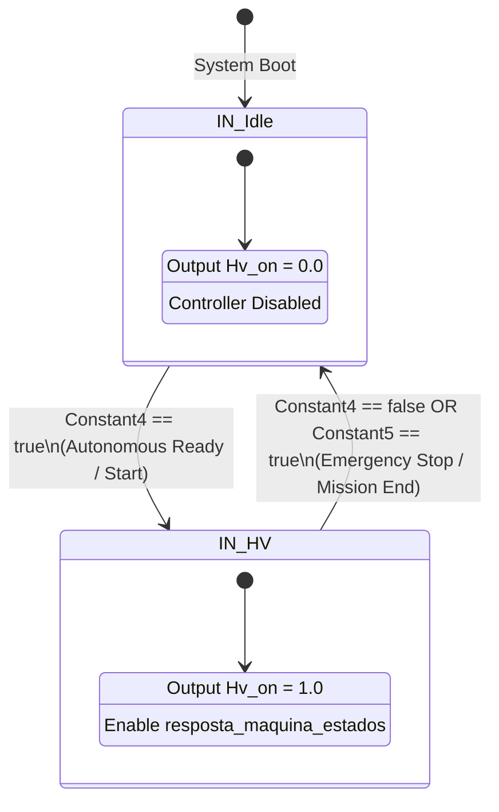
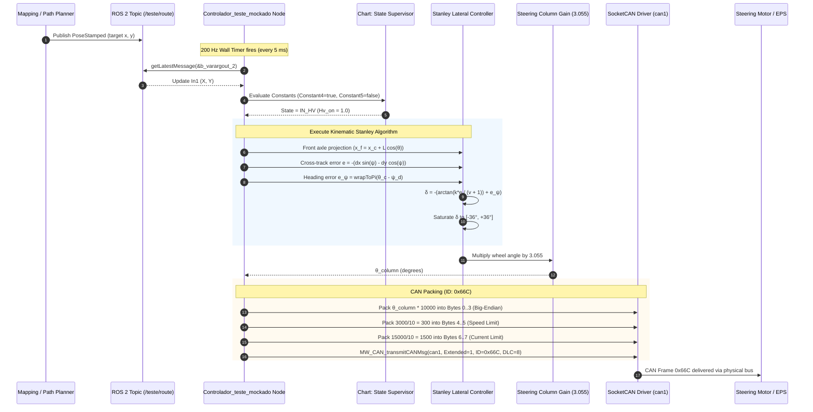

# Autonomous Formula SAE Controller: Comprehensive Architecture & Logic Documentation

> **Target Model:** `Controlador_teste_mockado`  
> **Source Platform:** MATLAB / Simulink 2023a (Embedded Coder / ROS 2 Toolbox)  
> **Target Hardware:** ARM 64-bit (LP64) Linux (NVIDIA Jetson / ROS 2 Foxy)  
> **Controller Type:** Kinematic Stanley Lateral Path-Tracking Controller + Supervisory State Machine  
> **Actuator Output:** CAN Bus (SocketCAN `can1`), Extended ID `0x66C` (1644 decimal)  

---

## 1. Executive Summary & System Overview

This codebase represents the autonomous lateral control system for an autonomous Formula SAE racing car. Generated automatically from a Simulink model using Embedded Coder (`ert.tlc`), the code integrates ROS 2 middleware for high-level messaging and Linux SocketCAN for deterministic low-level actuator communication.

The system's primary responsibility is to receive trajectory / waypoint data from the upstream perception and path-planning pipeline (Mapping / Route), determine the vehicle's lateral deviation and heading misalignment, calculate the required steering angle via a **Stanley Path-Tracking Controller**, convert the wheel steering angle into a steering column angle, and publish steering commands over the vehicle's CAN bus to the steering actuator (steering motor / EPS).

In this specific version (`Controlador_teste_mockado`), several vehicle state inputs (such as vehicle velocity and current vehicle pose) are "mocked" (fixed constants) to facilitate unit testing, benchtop verification, and standalone hardware-in-the-loop (HIL) or software-in-the-loop (SIL) validation.

---

## 2. Codebase Organization & File Roles

The folder `Codigo c++ controlador teste mockado` contains all necessary headers, sources, and conversion wrappers:

| File Name | Purpose & Contents |
| :--- | :--- |
| `main.cpp` | Instantiates `ros2::matlab::NodeInterface`, handles ROS 2 initialization, spin loop, and shutdown. |
| `ros2nodeinterface.h / .cpp` | Creates ROS 2 node `"Controlador_teste_mockado"`, multithreaded executor, and the 200 Hz wall-clock timer thread. |
| `Controlador_teste_mockado.h` | Model class declaration, signal definitions (`B_...`), persistent state storage (`DW_...`), and tunable parameter structures (`P_...`). |
| `Controlador_teste_mockado.cpp` | Core algorithmic logic: ROS message polling, Stateflow chart execution, Stanley controller math, steering ratio scaling, and CAN packet packing. |
| `Controlador_teste_mockado_data.cpp` | Static initialization of all default parameters, gains, limits, and constant structures. |
| `Controlador_teste_mockado_types.h` | Internal struct definitions: `bus_imu`, `bus_route`, `CAN_MESSAGE_BUS`, and ROS 2 bus wrapper structures. |
| `slros_busmsg_conversion.h / .cpp` | Bidirectional conversion functions between standard ROS 2 C++ messages (`geometry_msgs`, `std_msgs`) and Simulink internal bus representations. |
| `slros2_initialize.h / .cpp` | Instantiates the ROS 2 subscriber object `Sub_Controlador_teste_mockado_11`. |
| `MW_target_hardware_resources.h` | Code generation target configuration (ROS 2 Foxy, Jetson IP `192.168.10.11`, user `sauva`). |
| `rt_nonfinite.cpp`, `rtGetInf.cpp`, `rtGetNaN.cpp` | IEEE non-finite floating point utilities. |
| `rtwtypes.h` | Embedded coder primitive type aliases (`real_T`, `int32_T`, `boolean_T`, etc.). |

---

## 3. Execution Model & Timing

### 3.1 Real-Time Threading Architecture
The node uses a dual-mechanism threading model to guarantee strict real-time execution:

```
[ ROS 2 Multithreaded Executor ] 
           │
           │ Spin in background (Subscription callbacks)
           ▼
[ Wall-Clock Timer (5 ms / 200 Hz) ]
           │
           │ schedulerThreadCallback() -> Semaphore::notify()
           ▼
[ Base Rate Thread (baseRateTask) ]
           │
           │ Semaphore::wait() (Unblocks precisely every 5 ms)
           ▼
      mModel->step()
   (Execute Controller)
```

1. **ROS 2 Executor (`rclcpp::executors::MultiThreadedExecutor`)**:
   Runs in the background thread via `mExec->spin()`, listening for incoming messages on subscribed topics.
2. **Scheduler Timer (`mSchedulerTimer`)**:
   A ROS 2 wall timer configured with a period of **5,000,000 nanoseconds (5 ms = 200 Hz)**:
   ```cpp
   mSchedulerTimer = SLROSNodePtr->create_wall_timer(
       std::chrono::nanoseconds(5000000),
       std::bind(&NodeInterface::schedulerThreadCallback, this)
   );
   ```
3. **Synchronization Semaphore (`mBaseRateSem`)**:
   Every 5 ms, `schedulerThreadCallback` invokes `mBaseRateSem.notify()`. The dedicated thread `baseRateTask` unblocks and calls `mModel->step()`.
4. **Step Execution (`mModel->step()`)**:
   Processes the latest sensor/route data, computes control outputs, and transmits the CAN frame. The total step calculation takes $< 100 \ \mu\text{s}$, leaving ample CPU headroom.

---

## 4. Input Interface: Route & Mapping (ROS 2)

### 4.1 Topic & Subscription Specification
* **Topic Name:** `/teste/route`
* **Message Type:** `geometry_msgs/msg/PoseStamped`
* **QoS Settings:**
  * **History:** `KEEP_LAST`
  * **Depth:** `10`
  * **Reliability:** `BEST_EFFORT` (low latency, drops old packets if network lags)
  * **Durability:** `VOLATILE`

### 4.2 ROS 2 Message Structure
The incoming message follows the standard ROS 2 definition:
```
geometry_msgs/msg/PoseStamped
├── std_msgs/msg/Header header
│   ├── builtin_interfaces/msg/Time stamp (sec, nanosec)
│   └── string frame_id
└── geometry_msgs/msg/Pose pose
    ├── geometry_msgs/msg/Point position
    │   ├── float64 x  <--- [USED BY CONTROLLER: Target waypoint X]
    │   ├── float64 y  <--- [USED BY CONTROLLER: Target waypoint Y]
    │   └── float64 z  [Unused]
    └── geometry_msgs/msg/Quaternion orientation
        ├── float64 x  [Conversion generated, but bypassed in mock]
        ├── float64 y  [Conversion generated, but bypassed in mock]
        ├── float64 z  [Conversion generated, but bypassed in mock]
        └── float64 w  [Conversion generated, but bypassed in mock]
```

### 4.3 Input Signal Processing in Code
In `Controlador_teste_mockado::step()`:
```cpp
// Non-blocking query for the most recent message
b_varargout_1 = Sub_Controlador_teste_mockado_11.getLatestMessage(
    &Controlador_teste_mockado_B.b_varargout_2
);

// Enabled subsystem: update In1 ONLY when a new message arrives
if (b_varargout_1) {
    Controlador_teste_mockado_B.In1 = Controlador_teste_mockado_B.b_varargout_2;
}
```
* If no new message arrives during a 5 ms cycle, `In1` preserves its previous value, ensuring output continuity without sudden zero-drops.
* The waypoint coordinates are extracted:
  * `VectorConcatenate[0] = In1.pose.position.x`
  * `VectorConcatenate[1] = In1.pose.position.y`

### 4.4 Data Bus Definitions (`Controlador_teste_mockado_types.h`)
The architecture is designed around two primary application buses:

#### `struct bus_route` (Target Path Interface)
| Field | Type | Description | Unit |
| :--- | :--- | :--- | :--- |
| `desired_x` | `real_T` (double) | Target waypoint X coordinate | meters ($m$) |
| `desired_y` | `real_T` (double) | Target waypoint Y coordinate | meters ($m$) |
| `desired_yaw` | `real_T` (double) | Target path tangent angle | degrees ($^\circ$) |

#### `struct bus_imu` (Vehicle Odometry / State Interface)
| Field | Type | Description | Unit |
| :--- | :--- | :--- | :--- |
| `pos_x` | `real_T` (double) | Vehicle global X position | meters ($m$) |
| `pos_y` | `real_T` (double) | Vehicle global Y position | meters ($m$) |
| `pos_theta` | `real_T` (double) | Vehicle heading angle (yaw) | radians / degrees |
| `vel_x` | `real_T` (double) | Longitudinal velocity | $m/s$ |
| `vel_y` | `real_T` (double) | Lateral velocity | $m/s$ |
| `vel_yaw` | `real_T` (double) | Yaw rate ($r = \dot{\psi}$) | $rad/s$ |

---

## 5. Mocked vs. Real Vehicle State (Testing Configuration)

Because this codebase is `Controlador_teste_mockado`, several inputs that normally connect to real sensors (IMU, SLAM, wheel encoders) are replaced with constant blocks:

```
[ Real System Architecture ]                 [ Mocked Architecture in this Code ]
Localization Node -> Vehicle Pose (X, Y, Yaw)  ────> Constant (centro_cordenadas_carro = 0.0)
Wheel Encoders/IMU -> Forward Speed (v)        ────> Constant3 (1.0 m/s)
Mission Supervisor -> AS_State (HV Enable)     ────> Constant4 (true) & Constant5 (false)
Path Planner -> Desired Yaw                    ────> Constant2 (desired_yaw = 0.0 deg)
Path Planner -> Waypoint (X, Y)                ────> ROS 2 Topic (/teste/route) [REAL]
```

Specific constant values configured in `Controlador_teste_mockado_data.cpp`:
1. **Vehicle Current Pose (`currPose`)**:
   `Constant_Value_m = 0.0` $\implies (x_c = 0.0, y_c = 0.0, \theta_c = 0.0)$. The controller assumes the vehicle coordinate origin is momentarily coincident with $(0, 0, 0)$.
2. **Target Path Yaw (`desired_yaw`)**:
   `Constant2_Value.desired_yaw = 0.0` $\implies$ path orientation is treated as aligned with the X-axis ($0^\circ$).
3. **Vehicle Velocity ($v$)**:
   `Constant3_Value = 1.0` $\implies$ fixed at $1.0 \text{ m/s}$.
4. **Motion Direction (`Constant_Value_f`)**:
   `Constant_Value_f = 1.0` $\implies$ Forward motion mode active.

---

## 6. Supervisory State Machine (Stateflow Chart `<S2>/Chart`)

The controller includes an autonomous state supervisor to ensure the steering actuator only operates when high-voltage systems and autonomous mission checks are green:



### Transition Equations
* **Initial State:** `IN_Idle` (State value `2U`).
* **Condition to Transition `Idle` $\rightarrow$ `HV`:** `Constant4_Value == true`.
* **Condition to Transition `HV` $\rightarrow$ `Idle`:** `(!Constant4_Value) || Constant5_Value`.
* **In this mock:** `Constant4 = true` and `Constant5 = false`, meaning the state machine immediately transitions to `IN_HV`, holding `Hv_on = 1.0` and enabling continuous steering execution.

---

## 7. Lateral Control Logic: The Stanley Controller

The core path-tracking algorithm is the **Stanley Controller**, originally developed by Stanford University for the DARPA Grand Challenge and standard in autonomous motorsport due to its global asymptotic stability for lateral tracking.

```
                           Target Path Tangent
                                ▲
                                │  / 
                                │ /  ψ_d (Desired Yaw)
                                │/
            ┌───────────────────┼───────────────────┐
            │                   │                   │
            │               (x_d, y_d)              │
            │                                       │
            │           e (Cross-track error)       │
            │           ◄────────────────────────►  │
            │                                       │
            │                 [Front Axle] (x_f, y_f)
            │                     │ \
            │                     │  \  δ (Steering Angle)
            │                     │   \
            │                     │
            │               Wheelbase (L = 1.6m)
            │                     │
            │                     │
            │                [Rear Axle] (x_c, y_c)
            └───────────────────────────────────────┘
```

### 7.1 Coordinate Transformations & Front Axle Projection
Unlike pure-pursuit controllers which often track from the rear axle, the Stanley formulation tracks error **relative to the front axle center**:

$$\begin{aligned}
x_f &= x_c + L \cdot \cos(\theta_c) \\
y_f &= y_c + L \cdot \sin(\theta_c)
\end{aligned}$$

Where:
* $(x_c, y_c)$ = Rear axle / coordinate center of the car (`Constant_Value_m = 0.0`).
* $\theta_c$ = Vehicle heading (`currPose[2] = 0.0 rad`).
* $L$ = Wheelbase = `1.6 m` (`Kinematic_Wheelbase`).

When moving forward (`Constant_Value_f == 1.0`):
$$x_f = 1.6 \cdot \cos(0) + 0 = 1.6 \text{ m}, \quad y_f = 1.6 \cdot \sin(0) + 0 = 0.0 \text{ m}$$

### 7.2 Error Computations

#### 1. Difference Vector
$$\begin{aligned}
d_x &= x_f - x_{route} \\
d_y &= y_f - y_{route}
\end{aligned}$$

#### 2. Heading Error ($e_\psi$)
The difference between the car's heading ($\theta_c$) and the target path heading ($\psi_d$):
$$e_\psi = \theta_c - \psi_d$$
The code normalizes the angle into $[-\pi, \pi]$ using `Contro_angleUtilities_wrapTo2Pi`:
```cpp
b = (currPose[2] - VectorConcatenate[2]) + 3.1415926535897931;
Contro_angleUtilities_wrapTo2Pi(&b);
e_psi = b - 3.1415926535897931;
```

#### 3. Cross-Track Error ($e$)
The lateral perpendicular distance from the front axle to the path tangent:
$$e = -(d_x \cdot \sin(\psi_d) - d_y \cdot \cos(\psi_d))$$

### 7.3 Stanley Steering Law
The steering angle command $\delta$ consists of two distinct components:
1. **Heading Alignment Term:** Compensates for angular divergence ($e_\psi$).
2. **Cross-Track Correction Term:** An arctangent function that steers toward the path proportionally to lateral deviation, inversely scaled by speed:

$$\delta_{ideal} = -\left( e_\psi + \arctan\left(\frac{k_p \cdot e}{v + k_{soft}}\right) \right)$$

In the generated C++:
```cpp
Controlador_teste_mockado_B.angleInRadians = -(
    atan(
        -(d_idx_0 * sin(VectorConcatenate[2]) - cos(VectorConcatenate[2]) * d_idx_1)
        * Controlador_teste_mockado_P.stanley_kpfw
        / (Controlador_teste_mockado_P.Constant3_Value + 1.0)
    ) + (b - 3.1415926535897931)
);
```

#### Tunable Parameters:
* **Position Gain Forward (`stanley_kpfw`):** `5.0`
* **Position Gain Reverse (`stanley_kprv`):** `5.0`
* **Velocity Softening Factor ($k_{soft}$):** `1.0 m/s` (prevents division by zero at rest)
* **Velocity ($v$):** `Constant3_Value = 1.0 m/s`

### 7.4 Radian-to-Degree Conversion & Steering Saturation
The computed angle in radians is converted to degrees:
$$\delta_{deg} = \delta_{rad} \times \frac{180}{\pi} = \delta_{rad} \times 57.295779513082323$$

It then enters the saturation block `<S12>/Saturation`:
$$\delta_{wheel} = \text{clamp}(\delta_{deg}, -36.0^\circ, +36.0^\circ)$$
* Maximum wheel angle: `+36.0°` (`Saturation_UpperSat`)
* Minimum wheel angle: `-36.0°` (`Saturation_LowerSat`)

---

## 8. Steering Column Transmission Ratio

The Formula SAE vehicle uses a steering rack-and-pinion connected to a steering column driven by a rotary motor or EPS.

* The angle calculated by the Stanley controller ($\delta_{wheel}$) is the angle at the **front road wheels**.
* The actuator CAN frame requires the angle of the **steering column shaft** ($\theta_{column}$).

In `Controlador_teste_mockado.cpp`:
```cpp
// Gain: '<Root>/Gain'
Controlador_teste_mockado_B.Gain = Controlador_teste_mockado_P.Gain_Gain_i * 
                                  Controlador_teste_mockado_B.Saturation;
```
* **Gain Parameter (`curvatura_roda_para_coluna` / `Gain_Gain_i`):** **`3.055`**
* **Formula:**
  $$\theta_{column} = 3.055 \times \delta_{wheel}$$

#### Physical Range Example:
* Maximum left wheel: $+36.0^\circ \implies \theta_{column} = +36.0 \times 3.055 = \mathbf{+109.98^\circ}$
* Maximum right wheel: $-36.0^\circ \implies \theta_{column} = -36.0 \times 3.055 = \mathbf{-109.98^\circ}$

---

## 9. Output Interface: CAN Bus Specification

The computed column steering angle and actuator velocity/current limits are packed into a CAN message and transmitted via Linux SocketCAN.

### 9.1 Physical & Protocol Configuration
* **Hardware Socket:** `can1`
* **Driver Functions:** `MW_checkIFStatus`, `MW_createSocket`, `MW_CAN_transmitCANMsg`
* **CAN Frame Identifier:** `1644` (Decimal) $\implies$ **`0x0000066C`** (Hexadecimal)
* **Identifier Type:** **Extended CAN (29-bit identifier)** (`Extended = 1`)
* **Data Length Code (DLC):** `8` bytes
* **Frame Format:** Data Frame (`Remote = 0`)
* **Transmission Period:** Every 5 ms (200 Hz)
* **Byte Ordering:** **Big-Endian (Motorola)** across all signals

### 9.2 CAN Payload Bit-Field Layout

```
Bit:  0  1  2  3  4  5  6  7   8  9 10 11 12 13 14 15  16 17 18 19 20 21 22 23  24 25 26 27 28 29 30 31
Byte: └──────── Byte 0 ────────┘ └──────── Byte 1 ────────┘ └──────── Byte 2 ────────┘ └──────── Byte 3 ────────┘
      [============================ Signal 0: Steering Column Position ===============================]

Bit:  32 33 34 35 36 37 38 39  40 41 42 43 44 45 46 47  48 49 50 51 52 53 54 55  56 57 58 59 60 61 62 63
Byte: └──────── Byte 4 ────────┘ └──────── Byte 5 ────────┘ └──────── Byte 6 ────────┘ └──────── Byte 7 ────────┘
      [==== Signal 1: Speed Limit ====]                     [=== Signal 2: Accel / Current Limit ===]
```

### 9.3 Signal Definitions & Encoding Equations

#### Signal 0: Steering Column Target Position
* **Byte Span:** `Data[0]` (MSB) through `Data[3]` (LSB) — 32 bits
* **Data Type:** Signed 32-bit integer (`int32_T`)
* **Signal Layout:** Big-Endian (Motorola start bit 24)
* **Scaling Factor:** `0.0001` (Offset: `0.0`)
* **Source Variable:** `Controlador_teste_mockado_B.Gain` ($\theta_{column}$)
* **Encoding Formula:**
  $$\text{Raw}_{32} = \text{round}\left( \frac{\theta_{column}}{0.0001} \right) = \text{round}(\theta_{column} \times 10000)$$
* **Resolution:** $0.0001^\circ$ per bit count (e.g., $1.0^\circ = 10,000$ raw counts).
* **Bitwise Packing in Code:**
  ```cpp
  Data[0] = (uint8_T)((tempValue & 0xFF000000U) >> 24);
  Data[1] = (uint8_T)((tempValue & 0x00FF0000U) >> 16);
  Data[2] = (uint8_T)((tempValue & 0x0000FF00U) >> 8);
  Data[3] = (uint8_T)( tempValue & 0x000000FFU);
  ```

#### Signal 1: Steering Velocity / Speed Limit
* **Byte Span:** `Data[4]` (MSB) through `Data[5]` (LSB) — 16 bits
* **Data Type:** Signed 16-bit integer (`int16_T`)
* **Signal Layout:** Big-Endian (Motorola start bit 40)
* **Scaling Factor:** `10.0` (Offset: `0.0`)
* **Source Variable:** `Constant6_Value = 3000.0`
* **Encoding Formula:**
  $$\text{Raw}_{16} = \text{round}\left( \frac{3000.0}{10.0} \right) = \mathbf{300} \implies \mathbf{\text{0x012C}}$$
* **Bitwise Packing in Code:**
  ```cpp
  Data[4] = 0x01;
  Data[5] = 0x2C;
  ```

#### Signal 2: Steering Acceleration / Current Limit
* **Byte Span:** `Data[6]` (MSB) through `Data[7]` (LSB) — 16 bits
* **Data Type:** Signed 16-bit integer (`int16_T`)
* **Signal Layout:** Big-Endian (Motorola start bit 56)
* **Scaling Factor:** `10.0` (Offset: `0.0`)
* **Source Variable:** `Constant7_Value = 15000.0`
* **Encoding Formula:**
  $$\text{Raw}_{16} = \text{round}\left( \frac{15000.0}{10.0} \right) = \mathbf{1500} \implies \mathbf{\text{0x05DC}}$$
* **Bitwise Packing in Code:**
  ```cpp
  Data[6] = 0x05;
  Data[7] = 0xDC;
  ```

---

### 9.4 Concrete CAN Frame Value Reference Table

| Maneuver Scenario | Wheel Angle ($\delta$) | Column Angle ($\theta_{col}$) | Raw Signal 0 (Dec) | Full 8-Byte CAN Payload (Hex) |
| :--- | :--- | :--- | :--- | :--- |
| **Straight Ahead** | $0.00^\circ$ | $0.00^\circ$ | `0` | `00 00 00 00 01 2C 05 DC` |
| **Moderate Left** | $+10.00^\circ$ | $+30.55^\circ$ | `+305,500` (`0x0004A95C`) | `00 04 A9 5C 01 2C 05 DC` |
| **Moderate Right** | $-10.00^\circ$ | $-30.55^\circ$ | `-305,500` (`0xFFFB56A4`) | `FF FB 56 A4 01 2C 05 DC` |
| **Full Lock Left** | $+36.00^\circ$ | $+109.98^\circ$ | `+1,099,800` (`0x0010C818`) | `00 10 C8 18 01 2C 05 DC` |
| **Full Lock Right** | $-36.00^\circ$ | $-109.98^\circ$ | `-1,099,800` (`0xFFEF37E8`) | `FF EF 37 E8 01 2C 05 DC` |

---

## 10. Complete End-to-End Signal Tracing Diagram



---

## 11. Testing & Simulation Integration Roadmap

When preparing to validate this controller in a simulator (e.g., Gazebo, CARLA, MATLAB SIL, or an autonomous ROS 2 test harness), follow this step-by-step roadmap:

### Step 1: Setup Virtual CAN Interface (`vcan`)
If testing on Linux or WSL2 without physical CAN hardware:
```bash
sudo modprobe vcan
sudo ip link add dev can1 type vcan
sudo ip link set up can1
```
Verify traffic using `candump`:
```bash
candump can1
# Expected output when node runs:
# can1  0000066C   [8]  00 00 00 00 01 2C 05 DC
```

### Step 2: Bridge Waypoints from Simulation to ROS 2
Create a simulation adapter node that publishes to `/teste/route`:
* **Frequency:** 20 Hz to 50 Hz.
* **Message:** `geometry_msgs/msg/PoseStamped`.
* **Coordinates:** The waypoint $(x, y)$ can be sent in:
  * **Global Frame:** Requires un-mocking the car's current pose so the controller subtracts the real $(x_c, y_c)$.
  * **Vehicle-Local Frame:** If the planner transforms the lookahead waypoint to the car's frame (where $x_{car} \equiv 0, y_{car} \equiv 0, \theta_{car} \equiv 0$), the current mock will work **without changing a single line of code**, because the mock already assumes the car is at the local origin $(0, 0, 0)$!

### Step 3: Un-mocking Vehicle State Inputs (When ready for closed-loop)
To transition from the mock to full closed-loop control:
1. **Vehicle Pose (`currPose`):** Replace `Constant_Value_m` with an actual Odometry / Localization subscriber (`nav_msgs/msg/Odometry` or `bus_imu`).
2. **Path Tangent Yaw (`desired_yaw`):** Extract the yaw from `PoseStamped.pose.orientation` (quaternion to Euler yaw $\psi = \text{atan2}(2(wz + xy), 1 - 2(y^2 + z^2))$) and feed it into `desired_yaw` in degrees.
3. **Vehicle Speed ($v$):** Connect `Constant3` to the vehicle's actual forward wheel speed $v_x$ from encoders or state estimation.
4. **Safety & Mission Flags:** Link `Constant4` and `Constant5` to the Autonomous State Manager (AS System / Mission Selector).

### Step 4: Simulator Steering Actuator Consumer
In your simulation vehicle model (e.g., Gazebo plugin or Python ROS node):
1. Listen to `can1` using Python `python-can` or C++ SocketCAN.
2. Filter for arbitration ID `0x66C`.
3. Unpack bytes 0 to 3 as signed 32-bit big-endian integer:
   ```python
   import struct

   raw_angle = struct.unpack(">i", can_data[0:4])[0]
   column_angle_deg = raw_angle * 0.0001
   wheel_angle_deg = column_angle_deg / 3.055
   wheel_angle_rad = wheel_angle_deg * (3.14159265359 / 180.0)
   # Send wheel_angle_rad to vehicle steering joint
   ```
